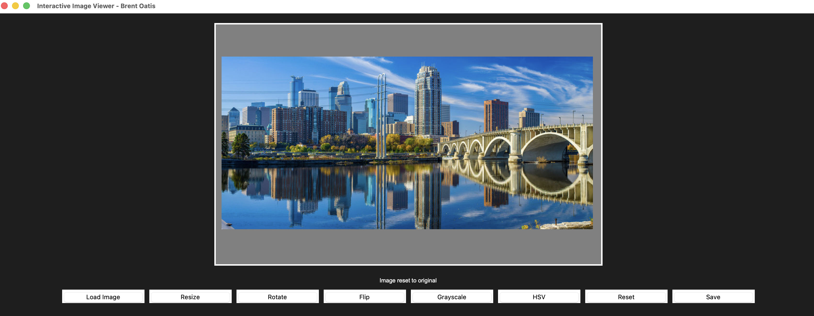
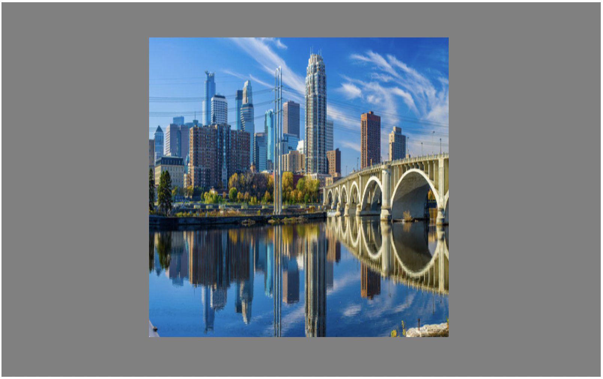
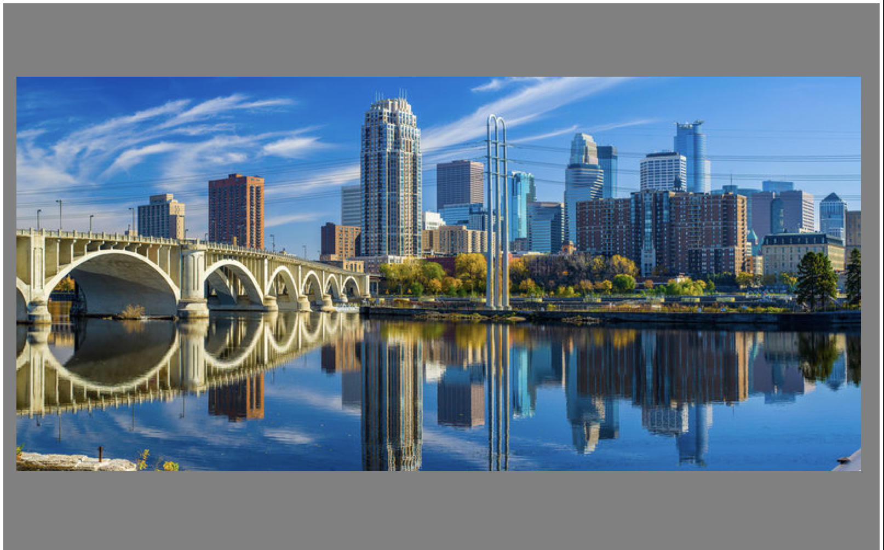
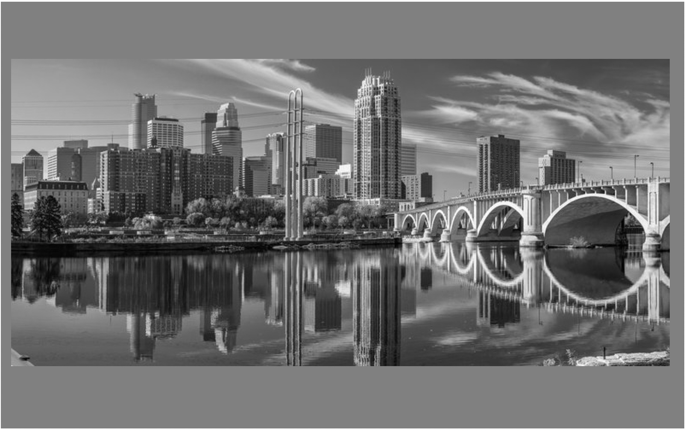
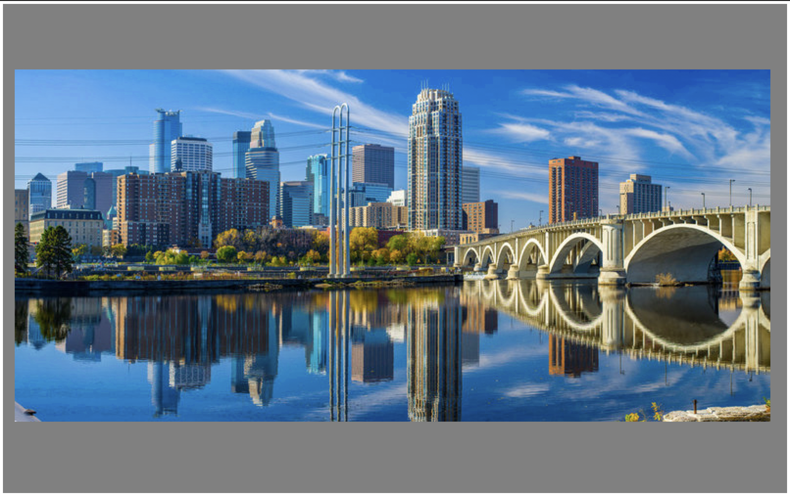
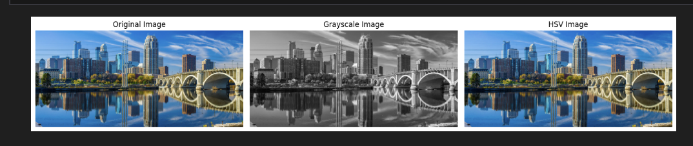

# CST 544 Week 1  
## Interactive Image Viewer with Transformations and Color Space Conversion

### Brent Oatis  
Concordia University, St. Paul  
CST 544 – Artificial Intelligence in Computer Vision  

---

# Project Overview

This project demonstrates foundational computer vision operations using Python, OpenCV, and Jupyter Notebook workflows. The application allows users to load images and apply basic image transformations including resizing, rotation, flipping, grayscale conversion, and HSV color space conversion.

The project was designed to simulate a lightweight image viewer tool for photographers, designers, and computer vision preprocessing workflows. The assignment also demonstrates how image preprocessing and color-space transformations influence downstream computer vision analysis.

---

# Technologies Used

- Python
- OpenCV
- Matplotlib
- NumPy
- Pillow (PIL)
- Jupyter Notebook
- VS Code

---

# Features

- Interactive image loading
- Resize transformation
- Rotation transformation
- Horizontal image flipping
- Grayscale conversion
- HSV color space conversion
- Image visualization and comparison
- GUI-based interaction using Tkinter

---

# Project Structure

```text
CST544_WEEK1_IMAGE_VIEWER/
│
├── .venv/
├── images/
│   ├── original_image.jpg
│   ├── grayscale_output.jpg
│   └── rotated_output.jpg
│
├── screenshots/
│   ├── gui_interface.png
│   ├── resize.png
│   ├── rotate.png
│   ├── flip.png
│   ├── grayscale.png
│   ├── HSV.png
│   └── final_comparison.png
│
├── Interactive_Image_Viewer.ipynb
├── interactive_image_viewer.py
├── README.md
├── requirements.txt
└── .gitignore
```

---

# Installation and Setup

## Clone the Repository

```bash
git clone YOUR_GITHUB_REPOSITORY_URL
```

---

## Create Virtual Environment

```bash
python3 -m venv .venv
```

---

## Activate Virtual Environment

### macOS/Linux

```bash
source .venv/bin/activate
```

---

## Install Required Libraries

```bash
pip install -r requirements.txt
```

---

# Running the Application

## Launch the GUI Application

```bash
python3 interactive_image_viewer.py
```

---

# Jupyter Notebook Workflow

The notebook demonstrates:

1. Image loading
2. Resize transformation
3. Rotation transformation
4. Flip transformation
5. Grayscale conversion
6. HSV conversion
7. Final visualization comparison

Launch notebook:

```bash
jupyter notebook
```

Open:

```text
Interactive_Image_Viewer.ipynb
```

---

# Sample Outputs

## GUI Interface



---

## Resize Transformation



---

## Rotation Transformation


---

## Flip Transformation



---

## Grayscale Conversion



---

## HSV Color Space Conversion



---

## Final Image Comparison



---

# Key Computer Vision Concepts Demonstrated

## Image Representation
The project demonstrates how digital images are represented through pixels, channels, and image matrices.

## Image Transformations
Transformations such as resizing, rotation, and flipping are essential preprocessing operations in computer vision pipelines.

## Color Spaces
The project demonstrates conversion between:
- RGB
- Grayscale
- HSV

HSV color space is especially useful in computer vision because it separates brightness from color information, improving robustness under changing lighting conditions.

## Visualization
Matplotlib was used to visualize image transformations and compare preprocessing outputs side-by-side.

---

# Key Insights

This project demonstrates that image preprocessing significantly impacts computer vision workflows. Proper transformations and color-space selection improve image consistency, model robustness, and downstream machine learning performance.

The project also reinforced the importance of reproducible notebook workflows, environment management, and visual debugging in computer vision engineering.

---

# References

GeeksforGeeks. (2022, August 24). *HSV color model in computer graphics*. GeeksforGeeks. https://www.geeksforgeeks.org/hsv-color-model-in-computer-graphics/

GeeksforGeeks. (2024, April 15). *What is OpenCV library?* GeeksforGeeks. https://www.geeksforgeeks.org/opencv-overview/

Herath, S. (2024, January 28). *Image manipulation and transformation with Python*. Medium. https://medium.com/image-processing-with-python/image-manipulation-and-transformation-with-python-006056705ee1

Rosebrock, A. (2023, February 20). *Basic image manipulations in Python and OpenCV: Resizing (scaling), rotating, and cropping*. PyImageSearch. https://pyimagesearch.com/2014/01/20/basic-image-manipulations-in-python-and-opencv-resizing-scaling-rotating-and-cropping/

---

# Author

Brent Oatis  
MBA Artificial Intelligence Program  
Concordia University, St. Paul